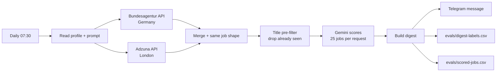

# JobPilot v0

> A daily Telegram digest of new Product Manager jobs in Germany and London, each scored 0–100 by AI against my profile, with a one-line reason.

**PM:** Prashant · **Status:** running daily since Nov 24, 2026, with the 5-day eval in progress (Sprint 2) · **Cost:** €0

## The problem
Checking job boards for PM roles in Germany and London took me about **1 hour a day**. I reran the same searches and skimmed dozens of ads that were the wrong level or not really PM roles, or that needed fluent German. Good roles still slipped past on busy days. Keyword alerts match words, not fit. A model can read the whole ad and judge it against what I'm looking for. Full problem statement: [docs/01-problem.md](docs/01-problem.md).

## What it does
Every morning at **07:30**, without me doing anything, JobPilot:
1. **Fetches** PM jobs from the last 24 hours: Germany from the Bundesagentur für Arbeit, London from Adzuna.
2. **Filters** out obvious non-PM titles and jobs it has already sent me.
3. **Scores** each job 0–100 with Gemini against an **anonymised** profile, with a reason and flags such as "German required".
4. **Sends** one Telegram message with the top 5 jobs, plus any other job scoring 70+ (up to 10).
5. **Logs** every scored job to a spreadsheet file, so I can browse them all and label the ones I was sent.

Example digest (illustrative):
```
JobPilot · Thu 26 Nov
80 DE + 27 London jobs fetched · 73 new scored · 14 at 70+

1. 92 · Senior Product Manager, Data
   <company> · London · UK · via Adzuna
   Senior PM in London with data/B2B SaaS focus; strong match on level and domain.

2. 88 · AI Product Owner (m/w/d)
   <company> · München · DE
   Strategic PO for an AI product in an English-speaking team; visa sponsorship unclear.
…
```
*A screenshot with personal details blurred will be added in P2-10.*

## Results so far
| Metric | Target | Result |
|---|---|---|
| Jobs found per day | n/a | **107** on the first run (80 Germany, 27 London) |
| Jobs scored per day | within the free tier | **75** in 3 Gemini requests, 55 s |
| Strong matches (85+) | n/a | **10** on the first run, 4 more at 70–84 |
| Digest arrives daily | 5 of 5 days | Delivered in the scheduled test on Nov 24; eval week in progress |
| Top-5 relevance (precision@5) | ≥ 70% | Being measured (P2-07), see [docs/04-evals.md](docs/04-evals.md) |
| Time spent checking jobs | under 10 min a day (from ~1 h) | Being measured (P2-07) |
| Cost | €0 | €0: free tiers only, no card on any service |

The most common reason a job scored low was **German required as a working language** (49 of 75 on the first run). So most strong matches are London roles, plus English-speaking teams in Germany.

## How it works

- **One n8n workflow, fixed steps, no agent.** The model only scores text; n8n decides what is sent ([workflows/jobpilot-v0.json](workflows/jobpilot-v0.json)).
- **Batching to stay free:** 25 jobs per Gemini request, about 3 requests a day, well inside the free daily limit.
- **Hard caps in the prompt** ([prompts/v1-fit-score.md](prompts/v1-fit-score.md)): not a PM role max 20, German required max 35, junior max 40, wrong location max 40.
- **No repeats:** each job ID is remembered for 30 days, so a job is scored and sent only once.
- **Bad days are visible:** if a source fails or nothing new came in, the message says so instead of silently not arriving.

Full design, data sources and first-run numbers: [docs/03-ai-design.md](docs/03-ai-design.md).

## Privacy and security
- **The CV never leaves my laptop.** Gemini only gets an anonymised profile (`profile/profile.md`, git-ignored), with no name, contact details, employer or school names. See [profile/profile.example.md](profile/profile.example.md) for the format.
- **No secrets in the repo.** The Adzuna, Gemini and Telegram keys are stored only in n8n's encrypted credentials on my laptop. The workflow file only points to them by ID.
- **The Telegram chat ID** is kept in a git-ignored file.
- **Only reachable from the laptop:** n8n listens on `127.0.0.1` only.
- **Job ads are treated as data:** the prompt tells the model to ignore any instructions written inside them.

## Key product decisions
- **n8n instead of a Python script:** visual, quick to change, and good for showing how it works. ADR in P2-08 (`docs/decisions/`).
- **Official or documented APIs only, no scraping:** that rules out LinkedIn and StepStone for v0.
- **Adzuna for London:** free key, personal job search allowed, but only a ~500-character snippet of each ad.
- **Title-only search for London:** cut 86 noisy results to 27 mostly real PM roles.
- **Short IDs per batch:** the model once shortened a long job ID, so batches now use 1, 2, 3… and map back by position.

## How I built it (step by step)
Each step is a GitHub issue in Sprint 2.

| Step | What I did | Issue |
|---|---|---|
| 1. Problem | Wrote the problem, user, v0 scope and success metrics ([docs/01-problem.md](docs/01-problem.md)) | P2-01 |
| 2. n8n in Docker | Ran n8n locally in Docker, pinned to version 2.49.5, reachable only from my laptop; created the local n8n owner account | P2-02 |
| 3. Germany jobs | Connected the Bundesagentur Jobsuche API: 4 search terms, last 24 h, full descriptions, de-duplicated | P2-03 |
| 4. London jobs | Got a free Adzuna developer key, saved it as an n8n credential, searched 3 PM titles in London | P2-04 |
| 5. Scoring | Wrote an anonymised profile and confirmed my targets (roles, cities, German level, work rights); saved a Gemini API key in n8n; wrote the scoring prompt | P2-05 |
| 6. Digest | Created a Telegram bot with @BotFather, saved its token in n8n, got my chat ID; scheduled the workflow for 07:30 and confirmed the message arrived | P2-06 |
| 7. Eval | Every digest now logs its jobs to `evals/digest-labels.csv`; I mark each one relevant Y/N for 5 days | P2-07 (in progress) |
| 8. Decision record | n8n vs Python | P2-08 (next) |
| 9. Workflow export | Workflow JSON in the repo, checked for secrets | P2-09 (next) |
| 10. Launch | Screenshot, retro, LinkedIn post | P2-10 (next) |

## Run it yourself
You need a Mac or PC with **Docker Desktop**, a **Telegram** account and three free keys. No credit card is needed anywhere.

**1. Get the code and start n8n**
```bash
git clone https://github.com/ai-pm-starter/p02-jobpilot.git
cd p02-jobpilot
docker compose up -d
```
Open http://localhost:5678 and create the local n8n owner account. This account exists only on your computer.

**2. Add your profile**
```bash
cp profile/profile.example.md profile/profile.md
```
Edit `profile/profile.md` with your **anonymised** profile and what you're looking for. Leave out your name, contact details and employer names: this is the text sent to Gemini.

**3. Create a Telegram bot**
1. In Telegram, message **@BotFather**, send `/newbot` and copy the bot token.
2. Send any message to your new bot.
3. Find your chat ID (for example by messaging **@userinfobot**) and save it:
```bash
echo "YOUR_CHAT_ID" > profile/telegram-chat-id.txt
```

**4. Get the free API keys**
- **Adzuna:** sign up at [developer.adzuna.com](https://developer.adzuna.com) for an `app_id` and `app_key`.
- **Gemini:** create a key in [Google AI Studio](https://aistudio.google.com/apikey). On the free tier Google may use what you send, which is why only the anonymised profile is sent.

**5. Add three credentials in n8n** (*Credentials → Add credential*)
| Name | Type | Value |
|---|---|---|
| Custom Auth account | Custom Auth | `{"qs": {"app_id": "…", "app_key": "…"}}` |
| Header Auth account | Header Auth | Name `x-goog-api-key`, value: your Gemini key |
| Telegram account | Telegram API | Your bot token |

**6. Import and connect the workflow**
1. In n8n: *Workflows → Import from file* → `workflows/jobpilot-v0.json`.
2. Open the nodes **Adzuna search**, **Gemini score** and **Send to Telegram**, and pick your credential in each one.
3. Click **Execute workflow** to test. A digest should arrive in Telegram within about a minute.
4. Click **Publish** so it runs every day at 07:30 (Berlin time; change the *Daily 07:30* node if needed).

**7. Keep it running**
- In Docker Desktop settings, turn on *Start Docker Desktop when you sign in*.
- The computer must be awake at 07:30; a missed day is not run later. On a Mac, this wakes it at 07:25 every day:
```bash
sudo pmset repeat wakeorpoweron MTWRFSU 07:25:00
```
- To stop it: `docker compose down`. Your workflows and credentials are kept in the Docker volume. `docker compose down -v` deletes them.

**Where things are**
| What | Where |
|---|---|
| All scored jobs (open in Excel or Numbers) | `evals/scored-jobs.csv` |
| Jobs sent in each digest, for labelling | `evals/digest-labels.csv` |
| Scoring prompt | `prompts/v1-fit-score.md` |
| Your profile and chat ID (git-ignored) | `profile/` |
| Past runs, step by step | n8n → *Executions* tab |
| Workflows, credentials, encryption key | Docker volume `p02-jobpilot_n8n_data`, never in the repo |

## Limitations and what's next
- **Runs on a laptop:** no digest if the laptop is asleep or off at 07:30.
- **London ads are scored on a ~500-character snippet**, not the full ad.
- **The Bundesagentur API is unofficial** and may change without notice.
- **Only one user, one profile.**
- **Next (v1 ideas):** cloud hosting, more sources, tailoring the CV and cover letter for the best matches.

## Built with
[n8n](https://n8n.io) 2.49.5 (self-hosted in Docker) · Google Gemini (`gemini-3.6-flash`, free tier) · Telegram Bot API · [Bundesagentur für Arbeit Jobsuche API](https://github.com/bundesAPI/jobsuche-api) (unofficial, community-documented) · [Adzuna API](https://developer.adzuna.com) (London jobs; data from Adzuna, personal use under its terms)
